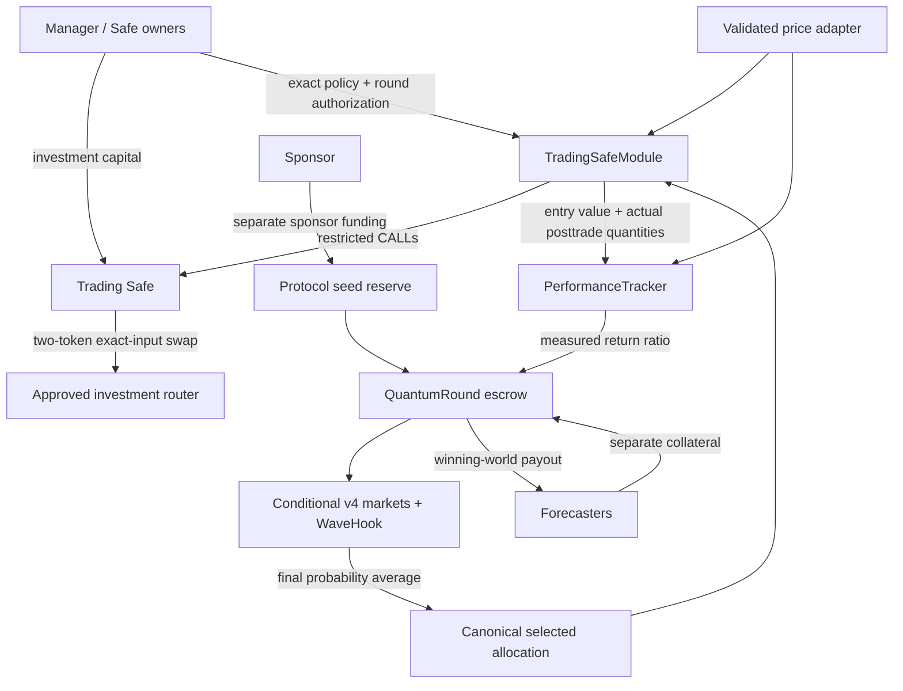

# Contracts v1 — implementation boundaries

## Money flow

The sponsor arrow is economic funding, not a permissionless seed API: v1's Safe-controlled engine admin must call addProtocolLiquiditySeed, which pulls tokens from that caller. Sponsor funds must be arranged separately before the trading snapshot. No investment assets are pulled into the round by the execution module.

## Lifecycle

1. Deploy and validate the stack. Token factory and registry retain only the engine controller; their admin roles are permanently removed. The Safe retains engine administration. Permanent registry sealing also disables its admin-only pause/slash-treasury changes; v1 never slashes proposer bonds.
2. Safe owners enable the module and authorize round ID, trading end, evaluation end, execution deadline, payout bounds and averaging window. The round ID is a monotonically increasing replay identifier.
3. Keeper opens the round. The engine calls the module to consume exact authorization and snapshot all eligible token quantities. Oracle validation must succeed. The engine opens Hold and funds its market from the seed reserve.
4. Registered proposers submit permitted allocation basis points with refundable bonds. Forecast depositors claim credits independently per proposal and trade through actual v4 pools. Seed depth cannot change while Trading.
5. Anyone collapses after trading end. Probability averaging determines the challenger; it must beat Hold by strictly more than 0.005. Proposal 0 means retaining existing quantities, even if its weight drifts with prices.
6. Anyone triggers module execution before its authorized deadline. The module checks frozen balances, canonical winner and immutable dependencies. Approval, swap, cleanup, postconditions, fixed-portfolio record and execution acknowledgment share one atomic EVM transaction.
7. After evaluation end, anyone invokes tracker settlement with no caller-supplied return. Valid fresh post-deadline prices mark the recorded posttrade quantities. The ratio compares this value to pretrade value, including execution costs.
8. Users redeem selected-world balances and unclaimed selected-world principal. Non-depositors holding transferred winning tokens can redeem. Deferred payouts remain backed after seed release/rescue.

## Signed-price follow-up

RedstonePortfolioOracle now provides a permissionless signature-verified USDC/ETH cache through the same read interface. See [the proof and fresh-feed gate](REDSTONE-PROOF.md); historical authenticity has been verified on Aurora by unsigned calls, but fresh data is not yet available without gateway access.

## Boundaries that remain visible

- Stablecoin 6 / asset 18 / CREDIT 6 / outcomes 18; USD prices and return ratios use 1e18.
- One instance per Safe; no multi-tenant shared liabilities, generic executor or WAVE share token.
- Non-rebasing, non-fee-on-transfer approved assets only. Other Safe assets are outside the eligible two-asset portfolio.
- A manager can still disable the module or change custody balances. Before execution this prevents execution; after execution measurement follows the recorded strategy, not arbitrary later account NAV.
- Latest-price observation inside a bounded window is subject to transaction timing. It is not authenticated historical pricing at an exact deadline.
- Oracle failure: unexecuted rounds can cancel after the execution window; the engine also retains a delayed permissionless emergency path. Executed rounds can never cancel at par, and delayed emergency settlement uses midpoint rather than invented performance.
- Arbitrary supplied oracle/router contracts are not safe by interface alone. Review bytecode, token/feed identity, provider privileges, freshness and venue liquidity before funding.
- Cancellation refunds original depositors at par; transferred outcome tokens do not gain a separate cancellation refund. This inherited behavior must be visible to secondary token holders.
- Protocol seed and active forecast participation are still required; custody modularity does not create liquidity or guarantee a useful decision signal.
- Local Foundry success is separate from actual Aurora deployment/gas/venue proof. No audited/production-safe claim is made.

## Reuse

Unchanged production contracts: ProposalToken, ProposalTokens, ProposerRegistry, WaveHook, WaveV4ProposalMarket. Adapted: QuantumRound and its integration interface. New: Safe module, tracker, price adapters, deployment orchestration and integration tests. WaveBase fixture deployment now loads compiled artifacts to avoid repeated large creation-code embedding; the underlying contracts execute unchanged.

No old WavefundVault, queued share deposits/withdrawals, Resolver return forwarding or WAVE share issuance is included. The upstream Arc fork test is retained only as a reference file outside the test directory; it is not an Aurora test.
